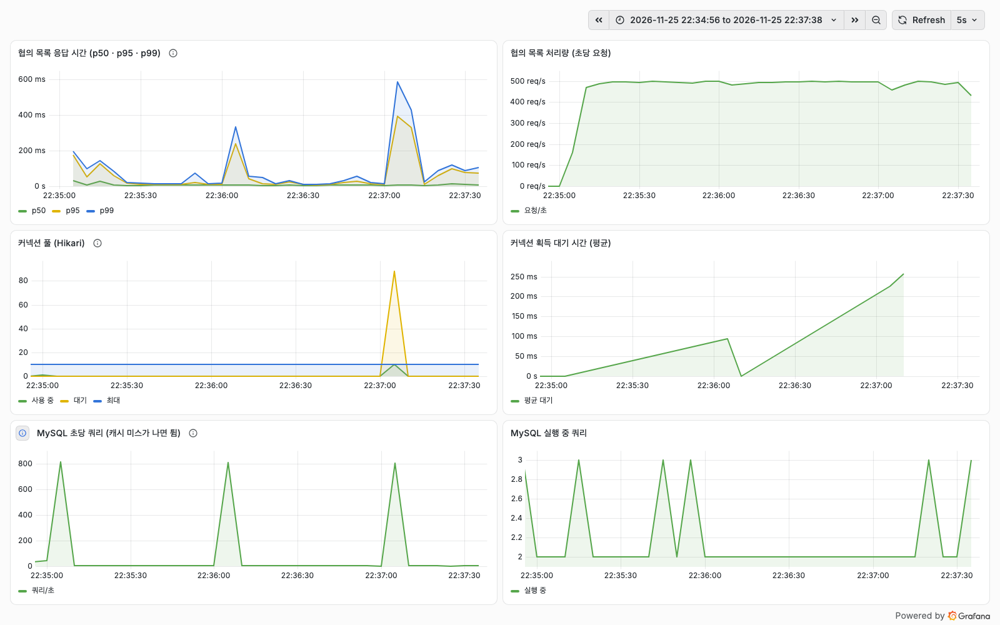
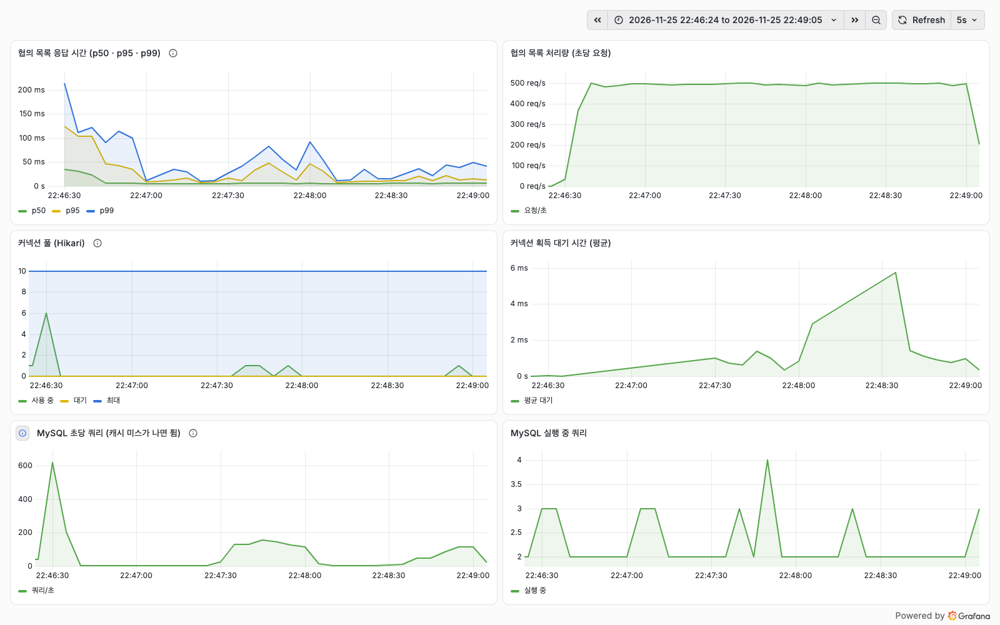

# 협의 목록 캐시 동시 만료 개선 (TTL jitter)

> 한 줄 요약: 캐시가 60초마다 한꺼번에 사라져 DB에 요청이 몰리던 문제를, 만료 시각을 60~90초 사이로 흩어 놓아 해결했다.

## 문제
- 협의 목록 Redis 캐시(`NegotiationListCache`)는 TTL이 **60초 고정**이다.
- 같은 시각에 채워진 키(사용자별 `negotiationList:{userId}`)들이 60초 뒤 **한꺼번에 만료**되고, 그 순간 요청이 모두 DB로 가면서 커넥션 풀(10개)이 꽉 찬다.
- 같은 키 하나에 몰리는 캐시 스탬피드가 아니라 **서로 다른 키가 동시에 만료**되는 문제라서, 같은 키 요청 병합(`Caffeine.get(key, loader)`)으로는 막을 수 없다.

## 변경
```java
// 변경 전
redis.expire(key, Duration.ofSeconds(60));
// 변경 후: 60초 + 0~30초 무작위
long jitter = ThreadLocalRandom.current().nextLong(JITTER_SECONDS + 1);
redis.expire(key, BASE_TTL.plusSeconds(jitter));
```

## 측정 방법
- 시나리오: `k6/negotiation-cache-expiry.js`. 사용자 500명이 첫 페이지만 1초 간격으로 150초 동안 조회한다. 시작할 때 모든 사용자의 캐시를 같은 순간에 채운다
- 환경: 로컬 Mac, Docker MySQL·Redis, 커넥션 풀 10, `local,loadtest` 프로필
- 공정성: 고친 뒤 측정 전에 앱을 20초 워밍업하고, 캐시가 모두 만료되도록 100초를 기다렸다
- 수집: k6 결과, Prometheus 지표, 캐시를 채운 지 59초·61초 시점의 스레드 덤프, JFR, Grafana 캡처

## 결과

| 지표 | 고치기 전 | 고친 뒤 | 
|---|---|---|
| 커넥션 대기 (최대) | **88건** | **0건** |
| 커넥션 획득 대기 (최대 평균) | 257ms | 5.8ms |
| 스레드 덤프 중 커넥션을 기다리는 요청 스레드 | 31 / 201개 | 0 / 202개 |
| 5초 구간 p95 최대 | 392ms (120초 만료 시점) | 125ms (시작 직후 콜드 스타트) |
| 최대 응답 시간 | 1,126ms | 322ms |
| 전체 p95 | 62.6ms | 36.4ms |
| 요청 수 / 에러 | 74,812 / 0건 | 75,223 / 1건* |

\* 측정 시작 직후(22:46:29) 로컬 연결 재설정(connection reset) 1건. 캐시와는 관계없다.

### 고치기 전: 60초마다 MySQL 쿼리가 초당 약 800건으로 치솟음


### 고친 뒤: 만료가 30초에 걸쳐 나뉘어 초당 100~150건 수준으로 완만해지고, 커넥션 대기가 사라짐


## 한계
- **처음 캐시가 비어 있을 때의 몰림(콜드 스타트)은 그대로다.** 두 측정 모두 시작 직후 MySQL이 초당 600~800 쿼리를 받았다. 줄이려면 사전 적재가 필요하다
- 로컬 단일 서버에서 측정했고, k6와 앱이 같은 PC의 CPU를 나눠 썼다
- 스레드 덤프는 정해진 시각에 찍었기 때문에, 만료 순간과 정확히 겹친 장면만 대기 스레드가 잡힌다

## 파일
- `comparison.json`: 전후 비교 데이터 (대시보드용)
- `before/`, `after/`: `metrics.json`(지표 원본·시계열), `k6-summary.json`, `k6-output.txt`, `grafana.png`, `threads/`(스레드 덤프), `jfr-summary.txt`
- JFR 원본(`before.jfr`, `after.jfr`, 각 11~15MB)과 나머지 스레드 덤프는 용량 때문에 `logs/evidence/`(gitignore)에 있다
